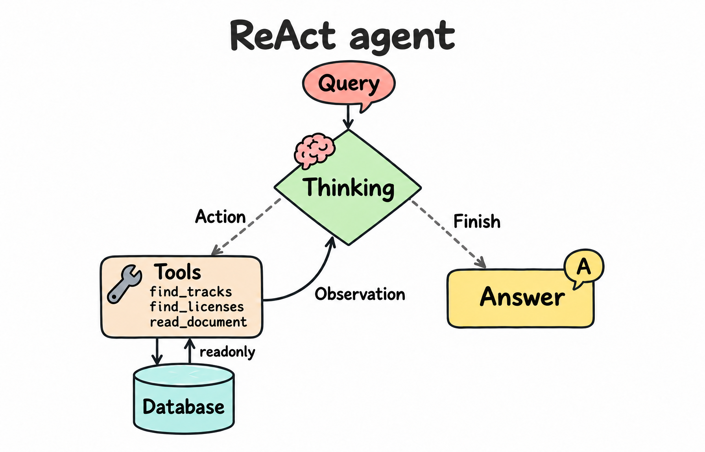

# ReAct Agent: Rockstar Muziek Catalogus

## Ontwerpkeuzes

Voor deze case is gekozen voor een ReAct-agent. 
De eindgebruiker praat in gewone taal, en de agent haalt tussendoor de data op. 
Dat zorgt voor een gesprek dat mensen al kennen van ChatGPT of Claude, maar dan begrensd voor een gesprek met deze catalogus.

Model: `gpt-6.2-sol`, reasoning effort `low`. `gpt-4.1-mini` gaf slechtere antwoorden op dezelfde vragen. 
Effort `medium` en `high` werden daarna geprobeerd: geen duidelijk beter antwoord, wel langer wachten op eind-antwoord.

Tools: `find_tracks`, `find_licenses`, `read_document`. Read-only — bronbestanden worden niet herschreven.

| Tool | Wat de agent ermee doet |
| --- | --- |
| `find_tracks` | Zoekt tracks in de catalogus (artiest / titel / ISRC) en plakt de bijbehorende rechtenregels erbij. |
| `find_licenses` | Filtert rechtenregels op eindjaar en/of ISRC. Lange resultaten gaan naar `results/licenses.csv`. |
| `read_document` | Leest één PDF: elke pagina wordt een genummerde afbeelding; het model krijgt die plaatjes plus een korte zoekvraag en levert een bewijsnotitie met paginanummers terug (geen OCR-pipeline). |

Data-kwaliteit (preprocessing / verrijking):

- Accenten worden genegeerd bij het zoeken, zodat `Bjork` ook `Björk` vindt.
- De opmerking noemt soms een ander jaar dan de einddatum.

  | isrc | territorium | licentie_start | licentie_eind | royalty_pct | exclusief | sync_toegestaan | opmerking |
  | --- | --- | --- | --- | --- | --- | --- | --- |
  | NLZ032411588 | EU | 28-04-2021 | 31-12-2028 | 18.0 | N | alleen NL | loopt af in 2025 |

  `find_licenses` filtert op einddatum, maar toont de (mogelijk conflicterende) opmerking wel in het resultaat.

Bronnen (alleen als de agent ze nodig denkt te hebben):

- `data/CATALOG_DUMP_2025-01-14_partial.dat`
- `data/tracks_rechten_export.csv`
- PDF’s in `data/documents/`

## Productie

Wat doen voordat je in productie zou gaan:

- Eerst gesprek hebben met eindgebruikers: user journey voor hoe de frontend eruit moet zien en hoe de eindgebruiker de applicatie wil gebruiken.
- Evaluatiemethode: hoe goed zijn de system prompt en het karakter van de agent, passen ze bij compliance, de scope van het bedrijf en de wensen van de eindgebruiker.
- Pipelines voor automatische prompt-optimalisatie (bijvoorbeeld DeepEval) en een regressietest voor prompts. Dat gebeurt nu handmatig tijdens het ontwerp.
- Pipelines voor linters en andere checks.
- API-contracten duidelijk maken.
- Unit tests, integration tests, end-to-end tests, evaluation tests / benchmarks, een cost test, een latency test en een stress test.
- logging

## Niet af

- De onderdelen besproken hierboven (wat doen voor productie).
- Een tool voor goed omgaan met aggregatie van data - zoals bij vraag 5. 
  `find_tracks` en `find_licenses` eisen een filter en tonen hooguit 50 rijen, dus "hoe groot is het probleem" kan de agent nu niet in één keer opmaken. 
  Die tool zou geen filter vragen en één overzicht teruggeven:

  - aantal catalogusrijen
  - hoeveel zonder ISRC
  - hoeveel met een ISRC maar zonder rechtenregel
  - hoeveel verschoven rechtenregels
  - hoeveel waarbij opmerking en einddatum botsen
  - dezelfde tellingen per artiest
